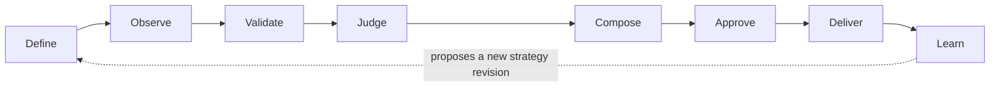
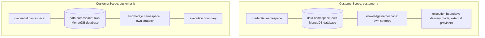
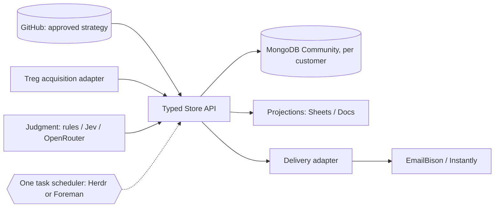

# Architecture

> **Status: design stage.** Only the contracts in `src/auggie/contracts/` exist. Every component
> below is labeled **Exists**, **Proposed** (recommended, not yet accepted or built) or **Open**
> (unresolved). Decisions are recorded in [`docs/adr/`](adr/README.md).

## Purpose

Auggie is a GTM-as-code harness. Approved strategy is versioned in Git. The harness turns it into
an evidence-to-action-to-learning loop for one customer at a time. It aims to produce:

- account intelligence that can be traced to dated sources,
- outreach a person has read and approved, and
- institutional knowledge that accumulates across runs and strategy revisions.

**Non-goals:** autonomous mass outreach, a hosted multi-tenant SaaS product, SMTP or sequencing
infrastructure, a CRM replacement, or a second task scheduler.

## The loop



| Stage | Responsibility | Contract / events | Status |
|---|---|---|---|
| Define | Approved strategy and configuration, versioned in Git | `StrategyRef`, `strategy.activated` | Contract exists |
| Observe | Acquire sources about an account; record every attempt | `SourceEvidence`, `evidence.recorded` | Contract exists |
| Validate | Admit usable evidence and reject the rest, keeping reasons | `evidence.validated`, `evidence.rejected` | Contract exists |
| Judge | Qualify against an exact strategy revision, citing evidence | `QualificationDecision`, `qualification.decided` | Contract exists |
| Compose | Write briefs and drafts from validated evidence only | `ArtifactRef`, `draft.composed` | Reference only; artifact contract proposed |
| Approve | A person approves one artifact version for one scope | `HumanApproval`, `approval.recorded` | Contract exists |
| Deliver | Hand approved drafts to an existing sending platform | `DeliveryTarget`, `delivery.simulated` | Simulated only |
| Learn | Record outcomes; propose strategy changes for human review | `outcome.recorded` | Event exists; learning proposed |

Learning never rewrites active strategy. A proposed change becomes a reviewed Git change, and only
later runs use it ([ADR 0005](adr/0005-evidence-and-approval-gates.md)).

## Where truth lives

| System | Holds | Authority | ADR |
|---|---|---|---|
| GitHub | Approved strategy and executable configuration | Authoritative for what is approved | [0003](adr/0003-systems-of-record.md) |
| MongoDB Community, one database per customer, behind a typed Store API | Evidence, decisions, approvals, events, outcomes | Operational system of record (planned) | [0003](adr/0003-systems-of-record.md) |
| Google Sheets / Docs | Customer-facing reports and review views | None: projections of the Store | [0003](adr/0003-systems-of-record.md) |
| EmailBison / Instantly | Sending | Delivery receipts only | [0006](adr/0006-delivery-through-existing-platforms.md) |
| SageOx | Shared engineering context and rationale | None over execution; never customer intelligence | [0011](adr/0011-sageox-engineering-context.md) |

Every operational record that depends on strategy carries a `StrategyRef`: Git commit, path and
content digest. Any result can be traced to the exact approved revision that produced it.

## Customer isolation

Each customer has a `CustomerScope` with isolated credentials, data, knowledge and execution
([ADR 0004](adr/0004-customer-isolation.md)):



- Every customer-bound record carries `customer_id`. An operation bound to one scope rejects
  records from another (`ensure_in_scope`).
- No two scopes may share a customer ID or any namespace (`check_isolated`).
- A synthetic scope cannot enable live delivery.
- Distinct names do not prove isolation. Deployments must also enforce it with separate
  credentials, database users and processes. The contracts catch misconfiguration; they are not
  a security boundary on their own.
- Customer deployments differ by configuration, not by code forks.

## Components



| Component | Role | Status |
|---|---|---|
| Contracts | Shared, versioned data shapes and invariants | **Exists** |
| Store API | The only path to operational data; typed operations; scope-bound | Proposed |
| MongoDB Community | Per-customer operational database behind the Store | Accepted, not built |
| Acquisition (Treg) | Data acquisition, recorded as `SourceEvidence` | Accepted, not built ([0008](adr/0008-treg-for-acquisition.md)) |
| Judgment and synthesis | Deterministic rules, Jev and OpenRouter under evaluation | **Open** ([0009](adr/0009-judgment-and-synthesis-engines.md)) |
| Task scheduler | Exactly one; Herdr or Foreman | **Open** ([0007](adr/0007-single-task-scheduler.md)) |
| Delivery adapter | Thin hand-off to EmailBison/Instantly; simulated first | Accepted, not built ([0006](adr/0006-delivery-through-existing-platforms.md)) |
| Projections | Sheets/Docs views generated from the Store | Accepted, not built ([0003](adr/0003-systems-of-record.md)) |

## Contracts

All contracts are immutable Pydantic models that reject unknown fields and carry a
`schema_version` ([ADR 0012](adr/0012-contract-conventions.md), Proposed).

| Contract | Key invariants enforced in code |
|---|---|
| `CustomerScope` | Synthetic scopes cannot deliver live; scopes cannot share namespaces |
| `SourceEvidence` | Acquired by a service or a human, never a model; retrieved means excerpt and hash; failed means a reason and no content |
| `QualificationDecision` | Facts and settled criteria cite evidence; hypotheses cannot settle a criterion; disqualifiers must be evidenced misses; citations must resolve to usable, in-scope evidence about the same account |
| `HumanApproval` | Human reviewers only; bound to an artifact hash and a scope; delivery approvals name a target; edits, expiry and revocation void it |
| `OperationalEvent` | Closed set of event types, each mapped to a loop stage and required record references; bounded flat attributes; idempotency key |

## First vertical slice

The first slice to build end-to-end. Today it exists only as a synthetic fixture
(`examples/synthetic/northstar-msp/`) that the tests check for consistency.

| Step | Stage | Records | Status |
|---|---|---|---|
| Research | Observe | `SourceEvidence` (including a failed retrieval), `evidence.recorded` | Fixture |
| Validate evidence | Validate | `evidence.validated`, `evidence.rejected` | Fixture |
| Qualify | Judge | `QualificationDecision`, `qualification.decided` | Fixture |
| Draft | Compose | `draft.md` plus `ArtifactRef`, `draft.composed` | Fixture |
| Human approval | Approve | Two `HumanApproval` records (content, delivery), `approval.recorded` | Fixture |
| Simulated delivery | Deliver | `delivery.simulated`, authorized by the delivery approval | Fixture |
| Record outcome | Learn | `outcome.recorded` | Fixture |

Until the scheduler decision is made, the slice will run as a plain sequential call chain:
no retries, leases or background execution.

## Proposed package layout

```text
src/auggie/
  contracts/     Exists    versioned data shapes and invariants; no I/O
  store/         Proposed  typed Store API; in-memory reference and MongoDB implementations
  acquisition/   Proposed  source adapters (Treg first) that emit SourceEvidence
  judgment/      Proposed  qualification engines behind one interface (ADR 0009)
  compose/       Proposed  brief and draft composition from validated evidence
  approval/      Proposed  review workflow over HumanApproval
  delivery/      Proposed  simulated adapter first; EmailBison/Instantly later
  projections/   Proposed  Markdown/CSV exports; Sheets/Docs views later
  cli/           Proposed  operator commands
examples/synthetic/  Exists  synthetic fixtures only
tests/               Exists
```

Scheduler integration has no package until ADR 0007 is decided.

## Open questions

These have no decision yet. Each needs an ADR before work depends on it.

- Task scheduler: Herdr or Foreman ([ADR 0007](adr/0007-single-task-scheduler.md)).
- Judgment and synthesis engines, and calibration thresholds for Jev
  ([ADR 0009](adr/0009-judgment-and-synthesis-engines.md)).
- Strategy file format and layout in Git.
- Per-customer deployment topology and sizing.
- Authentication and usage terms for provider CLIs in production.
- Google token refresh, and how approvals made in Sheets/Docs come back as proposals.
- Customer data ownership, retention and offboarding.
- Backup, restore and monitoring.
- Whether outcomes and artifacts become first-class contracts or stay as events and references.

## Related repositories

- [Auggie Research](https://github.com/AuggieGTM/auggie-research) and
  [Dale](https://github.com/AuggieGTM/dale): separate public repositories.
- The maintainer's private projects: nothing from them is copied here without a licensing and
  confidentiality review.

This harness does not rebuild their functionality.
